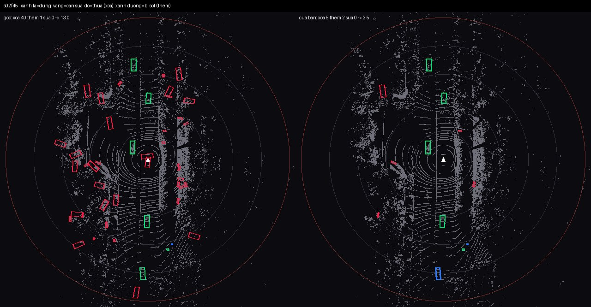

# Báo cáo Day 14 — Lưu Nhật Nam — 243


- Mã học viên dùng với `--student`: `243`
- `seed_tag` trong `frames_A.txt`: `393590736f`

## 1. Dự đoán trước sweep (bước 5b)

Ghi **trước** khi chạy `scripts/pp_sweep.py`, rồi commit và push ngay (lịch sử commit là bằng chứng thời điểm viết). Không sửa phần này sau khi có kết quả.

- Tham số dự đoán sẽ giảm công sửa nhiều nhất là `score_thr`. Tôi dự đoán tăng từ `0.1` lên `0.3` sẽ giảm tổng chi phí sửa trên tập A.
- Cơ sở từ số đo cấu hình gốc là 77 hộp cần xóa, 3 hộp cần thêm và 0 hộp cần sửa. Riêng s02f45 và s05f35 có tổng cộng 77 hộp cần xóa, chiếm 23.1 trong tổng chi phí 26.1. Tôi giả thuyết tăng ngưỡng sẽ loại được nhiều hộp thừa có điểm tin cậy thấp. Cần đối chiếu ảnh BEV và điểm `score` để kiểm tra giả thuyết này.
- Tăng ngưỡng cũng có thể loại hộp đúng và làm tăng số vật bị sót. Theo công thức của lab, loại được 4 hộp thừa nhưng bỏ sót thêm 1 vật sẽ giảm chi phí `4 × 0.3 - 1 = 0.2`. Vì vậy, tôi dự đoán ngưỡng trung bình có thể cân bằng hai tác động. Kết quả sweep và leave-one-out sẽ dùng để kiểm tra dự đoán.

> Bản nháp dự đoán được AI hỗ trợ soạn từ số đo cấu hình gốc. Người làm bài cần tự đối chiếu BEV và viết dự đoán của mình theo RULES.md trước khi nộp.

## 2. Tập A: sửa tay và tune

| Cấu hình | Xóa | Thêm | Sửa | Chi phí |
|---|---:|---:|---:|---:|
| Gốc | 77 | 3 | 0 | 26.1 |
| `best_config.json` | 13 | 4 | 0 | 7.9 |


Số đo cấu hình gốc trên từng frame:

| Frame | Dự đoán | Xóa | Thêm | Sửa | Chi phí |
|---|---:|---:|---:|---:|---:|
| s02f45 | 46 | 40 | 1 | 0 | 13.0 |
| s04f22 | 27 | 0 | 2 | 0 | 2.0 |
| s05f35 | 41 | 37 | 0 | 0 | 11.1 |
| Tổng | 114 | 77 | 3 | 0 | 26.1 |

Tổng 3 frame có 40 hộp tham chiếu và 37 hộp ghép khớp với dự đoán. Chi phí theo công thức của lab là `0.3 × 77 + 1.0 × 3 + 0.5 × 0 = 26.1`.

- Tham số đã đổi trong `best_config.json` là `score_thr`, tăng từ `0.1` lên `0.5`. `min_points` giữ ở `0`.
- Đã thử 15 cấu hình. Với `score_thr=0.5`, cả ba giá trị `min_points=0,5,10` đều có chi phí `7.9`. File cấu hình xuất ra chọn `min_points=0`.
- Kết quả leave-one-out từ terminal:

```text
s02f45: cấu hình chọn {'score_thr': '0.5', 'min_points': '0'} → 3.5 (tốt nhất có thể 3.5)
s04f22: cấu hình chọn {'score_thr': '0.5', 'min_points': '0'} → 2.0 (tốt nhất có thể 2.0)
s05f35: cấu hình chọn {'score_thr': '0.5', 'min_points': '0'} → 2.4 (tốt nhất có thể 2.4)
```

Cả ba lượt leave-one-out chọn cùng cấu hình `score_thr=0.5, min_points=0`. Chi phí trên mỗi frame bỏ ra bằng mức tốt nhất trong lưới thử của frame đó. Kết quả cho thấy lựa chọn nhất quán trên 3 frame A. Cần kiểm tra tiếp trên 12 frame B để đánh giá khả năng áp dụng sang dữ liệu khác.

- Tôi chọn `score_thr=0.5, min_points=0` để áp dụng cho tập B vì cấu hình này đạt chi phí thấp nhất trong 15 cấu hình đã thử, giảm từ `26.1` xuống `7.9`. Ba lượt leave-one-out đều chọn cùng cấu hình. Với ngưỡng `0.5`, tăng `min_points` lên 5 hoặc 10 cho cùng số đo trên tập A, nên tôi giữ giá trị 0. Số vật cần thêm tăng từ 3 lên 4, vì vậy khi sửa tập B tôi sẽ rà kỹ vật bị sót, nhất là các vật thưa điểm. Ngưỡng `0.5` là giá trị cao nhất trong lưới đã thử, nên kết quả chỉ xác nhận đây là lựa chọn tốt nhất trong lưới này.

## 3. Trước/sau (bước 8)



Chi phí trên từng frame:

| Frame | Gốc | Cấu hình tune |
|---|---:|---:|
| s02f45 | 13.0 | 3.5 |
| s04f22 | 2.0 | 2.0 |
| s05f35 | 11.1 | 2.4 |
| Tổng | 26.1 | 7.9 |

Chi phí giảm `18.2`, tương ứng `(26.1 - 7.9) / 26.1 × 100 ≈ 69.7%`. Script làm tròn tỷ lệ này thành `70%`. Số hộp cần xóa giảm từ `77` xuống `13`, số hộp cần thêm tăng từ `3` lên `4`, số hộp cần sửa giữ ở `0`.

Ảnh s02f45 hiển thị cấu hình gốc bên trái và cấu hình tune bên phải. Trên frame này, số hộp cần xóa giảm từ 40 xuống 5 và số hộp cần thêm tăng từ 1 lên 2, chi phí giảm từ 13.0 xuống 3.5.

Dự đoán ở mục 1 đúng về chiều thay đổi chi phí. Khi tăng `score_thr` từ `0.1` lên `0.3` và giữ `min_points=0`, số hộp cần xóa giảm từ 77 xuống 55, số vật cần thêm tăng từ 3 lên 4, số hộp cần sửa vẫn là 0. Chi phí giảm từ `26.1` xuống `20.5`, tương ứng khoảng `21.5%`.

Kết quả sweep chọn ngưỡng `0.5`, có chi phí `7.9`, thấp hơn mức `20.5` của ngưỡng `0.3` dự đoán ban đầu. So với cấu hình gốc, ngưỡng `0.5` giảm 64 hộp cần xóa và tăng 1 vật cần thêm. Mức giảm chi phí theo công thức là `64 × 0.3 - 1 × 1.0 = 18.2`. Kết quả phù hợp với giả thuyết tăng ngưỡng giúp giảm gánh nặng xóa hộp thừa, đồng thời cho thấy cần rà lại vật bị sót.


## 4. Tập B

Số đo từ `scripts/pp_prelabel.py --frames d14_243/frames_B.txt --config d14_243/best_config.json --gt d14_243/ref_B.json`, với cấu hình `score_thr=0.5, min_points=0`:

| Xóa | Thêm | Sửa | Chi phí |
|---:|---:|---:|---:|
| 27 | 17 | 5 | 27.6 |

Đủ 12 frame có nhãn. Trong phạm vi chấm 50 m, có 150 hộp tham chiếu và 160 hộp dự đoán, ghép khớp 133 cặp. Trong số các cặp đã ghép, 5 cặp được tính là cần sửa. Tổng chi phí là `0.3 × 27 + 1.0 × 17 + 0.5 × 5 = 27.6`.

| Frame | Dự đoán | Xóa | Thêm | Sửa | Chi phí |
|---|---:|---:|---:|---:|---:|
| s01f11 | 14 | 2 | 0 | 0 | 0.6 |
| s01f29 | 9 | 0 | 1 | 0 | 1.0 |
| s01f47 | 17 | 0 | 0 | 0 | 0.0 |
| s02f16 | 15 | 1 | 1 | 0 | 1.3 |
| s02f34 | 17 | 4 | 3 | 0 | 4.2 |
| s02f51 | 9 | 3 | 0 | 0 | 0.9 |
| s03f09 | 15 | 3 | 1 | 1 | 2.4 |
| s03f34 | 7 | 5 | 2 | 0 | 3.5 |
| s03f57 | 10 | 4 | 3 | 0 | 4.2 |
| s05f04 | 17 | 3 | 1 | 2 | 2.9 |
| s05f23 | 15 | 1 | 1 | 1 | 1.8 |
| s05f44 | 15 | 1 | 4 | 1 | 4.8 |
| Tổng | 160 | 27 | 17 | 5 | 27.6 |

Nhóm hộp tốn chi phí lớn nhất là các vật bị model bỏ sót cần vẽ thêm. Có 17 hộp cần thêm, đóng góp 17.0 vào tổng chi phí 27.6, tương ứng khoảng 61.6%. Xóa 27 hộp thừa đóng góp 8.1 và sửa 5 hộp đóng góp 2.5. Kết quả tổng hợp này chưa phân tách thao tác theo class.

Các frame có chi phí cao nhất là s05f44 với 4.8 và s02f34, s03f57 cùng mức 4.2. Frame s01f47 có chi phí 0.0 theo các ngưỡng so sánh của script.

## 5. Giới hạn

- Tập tune chỉ có 3 frame. Ba lượt leave-one-out cùng chọn một cấu hình là bằng chứng về tính nhất quán trên tập A, khả năng khái quát vẫn phụ thuộc dữ liệu mới.
- Model được huấn luyện trên KITTI và có ba lớp gốc Car, Cyclist, Pedestrian. Truck và Bus được suy ra qua luật kích thước, nên cần kiểm tra lại lớp trên dữ liệu VF, nhất là các vật bị che hoặc thưa điểm.
- Chi phí `0.3 × xóa + 1.0 × thêm + 0.5 × sửa` là số đo theo quy ước của lab. Chưa có log thời gian thao tác để quy đổi mức giảm chi phí thành số giờ làm việc.
- Mức giảm khoảng 69.7% được đo trên tập A dùng để tune. Tập B có tổng chi phí 27.6 với cấu hình đã chọn, chưa có số đo cấu hình gốc trên B để tính tỷ lệ giảm trên tập B.
- Script chấm các hộp có tâm trong 50 m và dùng các ngưỡng ghép/sửa cụ thể. Kết quả phụ thuộc chất lượng nhãn tham chiếu đã xuất từ CVAT và các ngưỡng đó.
